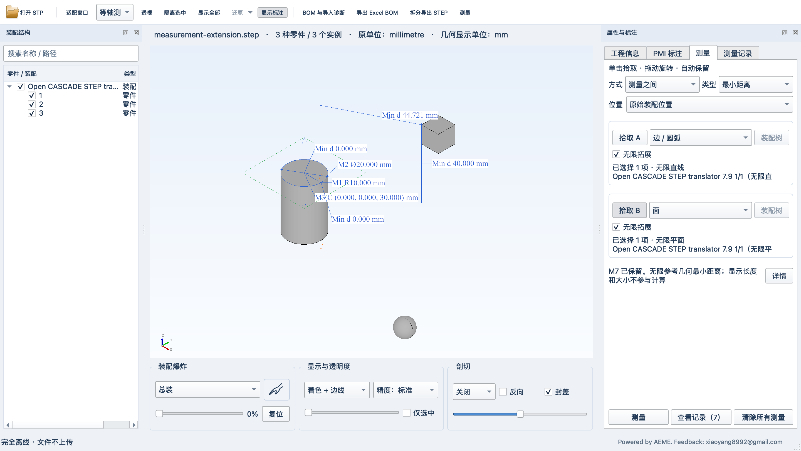

# STP Viewer

**面向 Mac 和 Windows 的中文、离线 STEP 工程查看器。**

STP Viewer 用于打开 `.stp` / `.step` 文件，查看三维零件与装配、提取工程信息、测量精确几何，并导出 Excel BOM 或拆分零件。文件在本机处理，应用不上传模型、不调用云服务，也不修改源 STEP 文件。

项目基于 [Mayo v0.10.0](https://github.com/fougue/mayo/tree/v0.10.0)，使用 Qt、Open CASCADE Technology 和 libxlsxwriter。当前版本为 **1.0 正式版**，适合工程查看、几何分析与功能验证。



## 主要功能

- **三维查看**：旋转、平移、缩放、标准视图、透视／正交、装配树、隔离、隐藏、透明、剖切与显示精度切换。
- **装配探索**：按总装或子装配爆炸；抓手拖动单个零件实例，松开后保留显示位置，支持复位和每文件独立状态。
- **工程信息**：读取文件中可获得的名称、编号、实例数量、材料和密度，计算包围盒、面积、有效体积及质量；缺失材料与密度可在当前会话补充。
- **独立测量**：点坐标、长度、半径、直径、面积、体积、质量、质量中心和体积中心。体积中心独立于密度；质量和质量中心要求有效密度。
- **对象之间测量**：点、边、面、实体、零件及装配汇总的最小距离，提供最近点和 ΔX／ΔY／ΔZ；按切线、法线或特征轴测量 0–90° 小夹角。
- **圆心、轴线与无限拓展**：拾取圆／圆弧圆心及圆／圆柱／圆锥参考轴；A、B 可分别将解析直线边或平面面无限拓展。轴线天然无限，显示长度不限制计算。
- **连续测量记录**：成功测量自动追加，操作页与记录页分开；支持复制、单条删除、隐藏标注和清除所有测量。每个文件标签独立保留会话记录。
- **Excel 与 STEP 导出**：导出四表 `.xlsx` BOM；按勾选实例范围拆分叶级零件，附带清单和诊断。导出使用原始精确几何及装配位置。
- **PMI 查看**：显示已识别的源图形与可验证的基础语义标注，并列出不支持、关联失败或显示失败的原因。

轴线和无限拓展测量的三维标签省略 M 编号与无穷符号，记录表保留编号。默认单位为 mm、mm²、mm³、kg、度，显示三位小数，可调整至六位。默认使用原始装配位置，也可测量包含爆炸和抓手位移的当前显示位置。

## 平台与便携方式

| 平台 | 构建产物 | 当前实测范围 |
|---|---|---|
| macOS Apple Silicon | `STPViewer.app`、arm64 便携 ZIP | Apple Silicon Mac 本机与 Retina，应用及独立解压副本实测 |
| Windows x64 | 完整目录便携 ZIP、单文件便携 EXE | Windows 10 x64 和 Windows 11 x64 中运行实测通过 |

Windows x64 的运行实测由项目作者确认，自动回归环境与验证范围详见 [验证说明](VALIDATION.md)。

Windows 单文件 EXE 可独立复制。首次启动将内嵌、校验后的运行库展开至 `%LOCALAPPDATA%\STPViewer\Portable\<包哈希>`，后续校验并复用缓存；无需管理员权限，不联网。它使用 .NET Framework 4.x 启动器，运行时使用展开后的 Qt／OCCT DLL 和资源。

Mac 应用使用本地 ad-hoc 签名，尚未做 Apple 公证；Windows 发行程序尚未做 Authenticode 签名。平台实测、自动回归及其他系统／显卡环境的验证范围见 [验证说明](VALIDATION.md)。本仓库提供完整源码及构建入口。

## 快速使用

1. 打开应用，点击“打开 STP”或拖入一个或多个 STEP 文件。
2. 在装配树或三维视图选择对象；右侧查看工程信息与 PMI，底部使用爆炸、显示和剖切操作。
3. 点击“测量”，选择“测量对象”或“测量之间”，分别拾取所需对象，再点击“测量”。结果会自动保留。
4. 在“测量记录”页复制、隐藏、删除或清除结果；通过顶部按钮导出 Excel BOM 或拆分 STEP。

默认左键拖动旋转，右键拖动平移，滚轮缩放；双击或按 F 适配窗口。抓手与测量拾取互斥。Windows 多选使用 Ctrl，Mac 使用 ⌘。测量、人工属性与显示位置只保留于文件会话，关闭或重新读取文件后清空。

## 从源码构建

固定依赖为 Qt **6.8.3**、OCCT **7.9.3**、libxlsxwriter **1.2.4**；版本与下载校验见 [依赖锁定文件](scripts/dependencies.lock.json)。依赖下载和构建首次需要联网，生成的应用在本机离线运行。

### macOS arm64

需要 Apple Silicon Mac、Xcode Command Line Tools 和 Python 3。

```sh
bash scripts/bootstrap-macos.sh --jobs 6
export PATH="$PWD/.tools/venv/bin:$PATH"
cmake -C .deps/paths.cmake -S . -B build -G Ninja \
  -DCMAKE_BUILD_TYPE=Release -DCMAKE_OSX_ARCHITECTURES=arm64 \
  -DCMAKE_OSX_DEPLOYMENT_TARGET=12.0 -DSTP_BUILD_TESTS=ON
cmake --build build --target STPViewer stp_core_tests stp_measurement_tests stp_pmi_tests stp_job_queue_tests --parallel 6
ctest --test-dir build --output-on-failure
bash scripts/package-macos.sh build/STPViewer.app
```

### Windows x64

需要 Visual Studio 2022 C++ Build Tools、Windows SDK 和 Python 3.12+。双击 `build-windows.cmd`，或在普通 PowerShell 运行：

```powershell
./scripts/build-windows.ps1 -Jobs 4
```

入口初始化编译器、准备固定版本依赖、运行回归并生成 ZIP 和单文件 EXE。界面与打包自检需要可用图形桌面和 OpenGL。详细配置见 [Windows 构建说明](WINDOWS_BUILD.md)及[使用与构建说明](STP_README.md)。GitHub Actions 提供手动触发的双平台便携构建。

## 文档与样例

- [完整使用说明](STP_README.md)
- [工程测量说明](doc/stp_mac_measurement.md)（保留原文件名，Mac／Windows 均适用）
- [Windows 测量与单文件 EXE](doc/stp_windows_measurement.md)
- [抓手摆放说明](doc/stp_mac_part_grab.md)
- [样例及来源](samples/README.md)
- [测试与已知边界](VALIDATION.md)
- [参与开发](CONTRIBUTING.md)

`measurement-reference.step` 可体验半径、直径、圆心、轴线和中心测量；`measurement-extension.step` 可对比有界几何与无限直线／平面的距离。质量测量前需提供有效密度。

## 使用边界

PMI 支持取决于源 STEP 内容与 OCCT 的读取结果，识别数量不代表全量保真。拆分导出中的缺失或语义变化会写入诊断。几何 BOM 反映文件的定义与实例组织，不能自动恢复企业正式 EBOM。

体积及中心面向有效封闭实体；装配按实例累加，不做布尔融合、不扣除重叠体积。超大型真实工程装配、最低系统版本与全部 CAD 导出组合仍需进一步验证。测量记录保留于会话；未提供跨文件测量、CSV 导出或手动坐标输入。

## 许可与致谢

源码沿用 [BSD-2-Clause 许可](LICENSE.txt)，保留 Mayo／Fougue SAS 的原始版权声明。Qt、OCCT 和其他第三方组件保留各自许可，详见 [第三方声明](THIRD_PARTY_NOTICES.md)。Mayo 原始介绍保存在 [README-Mayo.md](README-Mayo.md)。

应用署名为 **Powered by AEME**。问题与建议可通过 GitHub Issues 提交，应用内保留反馈邮箱 **xiaoyang8992@gmail.com**。
